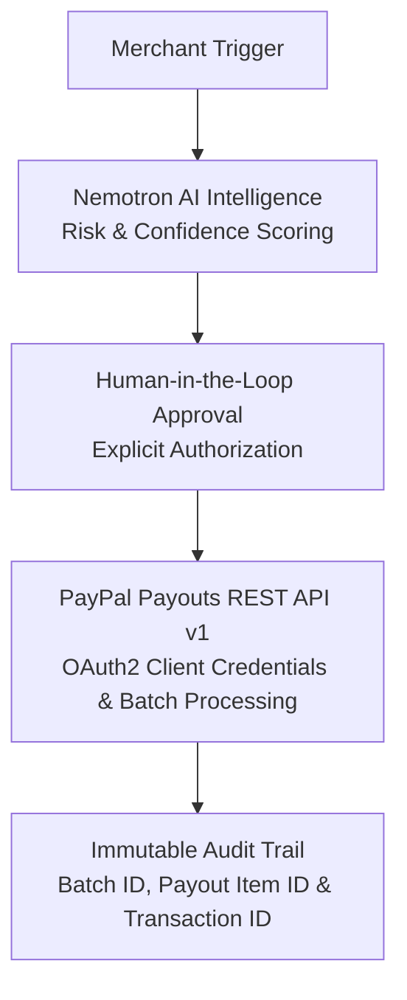

# Afferent Commerce — Autonomous Agentic Commerce & Physical Quality Control Engine

[](https://opensource.org/licenses/MIT)
[](https://www.python.org/)
[](https://fastapi.tiangolo.com/)
[](https://reactjs.org/)
[](https://developer.paypal.com/)
[](https://build.nvidia.com/)

> **BLUF (Bottom Line Up Front):** **Afferent Commerce** es un motor de comercio agéntico autónomo que vincula la evaluación somatosensorial y tribológica de productos físicos en tiempo real con la ejecución financiera automatizada mediante **PayPal Payouts REST API**. Utilizando telemetría táctil, razonamiento con **NVIDIA Nemotron** y un flujo **Human-in-the-Loop**, el sistema decide y ejecuta liquidaciones B2B con trazabilidad completa.

---

## 🏆 Demo Video

**Demo Video:** [Link to 60-second demo video]

---

## 🧩 The Problem

Las liquidaciones B2B tradicionales dependen de revisiones manuales, son lentas, propensas a error y generan fricción operativa. Cuando el pago se libera sin validar la calidad física del producto, el riesgo de fraude, disputas y pérdidas aumenta.

---

## 💡 The Solution

**Afferent Commerce** es un agente autónomo que:

1. Ingiere telemetría física y señales de calidad.
2. Evalúa riesgo mediante un motor de IA.
3. Genera una recomendación explicable con nivel de confianza.
4. Solicita aprobación humana explícita.
5. Ejecuta el pago real mediante **PayPal Payouts REST API**.
6. Registra un audit trail inmutable con IDs de transacción.

Resultado: un flujo financiero automatizado, auditable y alineado con criterios enterprise.

---

## 🏗️ Architecture



### Key Application Modules
- **Tactile Quality Inspection:** telemetría espacial, deformación, fricción acústica y señales de riesgo.
- **AI Quality Assessment:** NVIDIA Nemotron, scoring 0-100, recomendación `APPROVE`, `REVIEW`, `HOLD` o `REJECT`.
- **PayPal Payment Execution:** Payouts REST API, OAuth2 client credentials y procesamiento de lotes.
- **Transaction Center:** visualización de `Batch ID`, `Payout Item ID`, `Transaction ID` y estado.
- **Audit Trail:** timeline auditable de cada decisión y acción.
- **Command Center UI:** dashboard React/Vite con layout 3-6-3, observabilidad y métricas ejecutivas.

---

## 🛠️ Tech Stack

| Layer | Technology |
|---|---|
| Frontend | React, TypeScript, Vite, Tailwind CSS, Framer Motion |
| Backend | FastAPI, Python, Pydantic |
| AI | NVIDIA Nemotron |
| Payments | PayPal Payouts REST API v1 |
| Observability | Agent Observability Center, Decision Trace, System Health |
| Deployment | Docker, Docker Compose |

---

## ⚙️ Installation

### Quick Start

```bash
docker-compose up
```

### Local Development

Backend:

```bash
cd apps/api
uvicorn app.main:app --host 0.0.0.0 --port 8000 --reload
```

Frontend:

```bash
cd apps/web
npm install
npm run dev
```

Environment variables:

```env
PAYPAL_CLIENT_ID=your-paypal-sandbox-client-id
PAYPAL_CLIENT_SECRET=your-paypal-sandbox-client-secret
PAYPAL_MODE=sandbox
NEBIUS_API_KEY=your-nebius-api-key
NEBIUS_BASE_URL=https://api.tokenfactory.nebius.com/v1/
NEBIUS_MODEL=nvidia/nemotron-3-super-120b-a12b
```

---

## 💳 PayPal Integration Architecture & Payout Flow

Afferent Commerce replaces traditional Checkout flows with an **automated mass-settlement architecture** based on PayPal's modern REST API.

```text
[Merchant Trigger]
↓
[Nemotron AI Intelligence] (Risk & Confidence Scoring)
↓
[Human-in-the-Loop Approval] (Explicit Authorization)
↓
[PayPal Payouts REST API v1] (OAuth2 Client Credentials & Batch Processing)
↓
[Immutable Audit Trail] (Batch ID, Payout Item ID & Transaction ID)
```

### Key Integrated Endpoints

- `POST /api/v1/paypal/payout`: Dynamic OAuth2 token generation and direct recipient batch transfer execution.
- `GET /api/v1/paypal/payouts/{payout_item_id}`: Real-time status monitoring with support for `SUCCESS`, `PENDING`, or `UNCLAIMED`.

---

## 🚀 Winning Flow

1. **Ingestion:** The system receives order, telemetry and merchant data.
2. **AI Evaluation:** Nemotron analyzes risk, merchant history and quality signals.
3. **Recommendation:** The agent generates `recommendedAmount`, `riskLevel`, `confidenceScore` and `recommendedAction`.
4. **Human Approval:** The operator explicitly approves or rejects the recommendation.
5. **PayPal Execution:** The backend calls PayPal Payouts REST API and creates a real Sandbox payout.
6. **Audit Trail:** The UI displays `Batch ID`, `Payout Item ID`, `Transaction ID`, status and the full decision timeline.

---

## 🏁 Quality Checklist

- [x] PayPal Sandbox: real transaction IDs are displayed in the UI.
- [x] Real AI: the recommendation changes based on risk and merchant data.
- [x] Human-in-the-Loop: the final execution is triggered by explicit approval.
- [x] Clean Build: `npm run build` exits with code 0.
- [x] Enterprise UI/UX: command-center layout with 3-6-3 grid, observability and executive metrics.
- [x] Synchronization: frontend and backend are connected for the demo flow.

---

## 👤 Author

**Raúl Rodríguez Mesia**  
Senior AI Prompt Consultant, Data Annotator & Backend Infrastructure Engineer  
Tumbes, Peru  
GitHub: [@raulrodriguezmesia-blip](https://github.com/raulrodriguezmesia-blip)  
Portfolio: https://raulrodriguezmesia-blip.github.io/