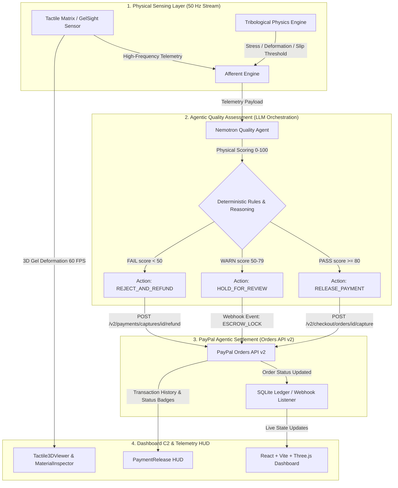

# Afferent Commerce — Autonomous Agentic Commerce & Physical Quality Control Engine
[](https://m8ven.ai/mcp/raulrodriguezmesia-blip/afferent-omni?s=readme)
[](https://opensource.org/licenses/MIT)
[](https://www.python.org/)
[](https://fastapi.tiangolo.com/)
[](https://reactjs.org/)
[](https://threejs.org/)
[](https://developer.paypal.com/)
[](https://build.nvidia.com/)

> **BLUF (Bottom Line Up Front):** **Afferent Commerce** es un motor de comercio agéntico autónomo (*Agentic Commerce*) que vincula la captura condicional de fondos mediante la **PayPal Orders API v2** a la evaluación somatosensorial y tribológica de productos físicos en tiempo real. Utilizando telemetría táctil a 50 Hz y razonamiento multimodal alimentado por **NVIDIA Nemotron**, el agente decide autónomamente si **libera el pago (*Capture*)**, **mantiene los fondos en custodia (*Escrow Hold*)** o **inicia un reembolso automático (*Refund/Reject*)** según los criterios de calidad física del producto.

---

## 📐 System Architecture



---

## 🌟 Key Features & Innovations

- **Closed-Loop Agentic Escrow:** Elimina los fraudes de calidad en e-commerce y cadenas de suministro B2B. El agente autoriza transacciones financieras de PayPal de forma condicional únicamente tras la verificación somatosensorial del objeto.
- **50 Hz WebSocket Telemetry Streaming:** Transmisión de baja latencia con perfiles neuromórficos, límites de cizallamiento, distribución de esfuerzo (stress heatmap) y firmas acústico-friccionales.
- **Physics-Aware Tribological Engine:** Base de datos de materiales físicos (glass, rock, egg, strawberry, metal, tissue) con cálculo en tiempo real de módulo de Young ($E$), coeficiente de fricción ($\mu_s$), límite de esfuerzo cortante y margen de seguridad de agarre.
- **PayPal Orders API v2 Client Native Integration:** Soporte nativo OAuth2 con actualización automática de token, flujo de creación de órdenes con retención agéntica, captura (capture) y Webhooks.
- **NVIDIA Nemotron Reasoning Layer:** Diagnóstico explicable estructurado (JSON) que genera la puntuación de calidad (0–100), nivel de confianza y justificación técnica para auditar la decisión de pago.
- **Interactive 3D Gel Deformation Canvas:** Renderizado dinámico en Three.js con desplazamiento Z de vértices en tiempo real para visualizar la deformación física bajo presión de agarre.

---

## 🛠️ Tech Stack & Dependencies

### Backend (Python / FastAPI)
- **Framework:** Python 3.11+, FastAPI v3.0.0, Uvicorn, Pydantic v2.
- **Integración de Pagos:** PayPal Orders API v2 HTTP Client (vía httpx asíncrono).
- **LLM Engine:** NVIDIA Nemotron 3.5 Super VL vía Nebius Token Factory API / OpenAI SDK.
- **Modelos Físicos & Análisis:** NumPy, SciPy, SQLite3 (Persistencia de transacciones).

### Frontend (React / TypeScript / Vite)
- **Core:** React 18, TypeScript, Vite.
- **Gráficos 3D & UI:** Three.js, @react-three/fiber, @react-three/drei, Tailwind CSS, Lucide React icons.
- **Comunicación:** WebSockets nativos (useTactileStream), Axios.

---

## 📂 Repository Structure

```
afferent-agentic-commerce/
├── apps/
│   ├── api/                           # FastAPI Backend Engine
│   │   ├── app/
│   │   │   ├── main.py                # Entrada principal de FastAPI & Rutas
│   │   │   ├── routers/
│   │   │   │   ├── payments.py        # Router PayPal Orders API v2 & Calidad
│   │   │   │   ├── stream.py          # WebSocket Telemetry Server (50 Hz)
│   │   │   │   ├── chat.py            # Asistente de IA (Intenciones de Comercio)
│   │   │   │   ├── infer.py           # Vision-to-Touch Inference Endpoint
│   │   │   │   ├── health.py          # Health Check
│   │   │   │   ├── anomaly.py         # Anomaly Detection & Predictive Maintenance
│   │   │   │   ├── calibration.py     # Bayesian Material Calibration
│   │   │   │   ├── compliance.py      # ISO/IEC Conformity Report
│   │   │   │   ├── grasp.py           # Zero-Shot Grasp Planning
│   │   │   │   └── replay.py          # Session Replay & Data Logging
│   │   │   └── services/
│   │   │       ├── paypal_client.py   # Cliente OAuth2 & Rest API de PayPal
│   │   │       ├── quality_agent.py   # Agente de Evaluación Nemotron
│   │   │       ├── physics_engine.py  # Motor de Física & Tribología
│   │   │       ├── afferent_engine.py # Vision-to-Touch Inference Engine
│   │   │       ├── session_store.py   # Persistencia SQLite
│   │   │       ├── anomaly_detector.py# Statistical Anomaly Detection
│   │   │       ├── material_calibration.py # Bayesian Micro-Probe Calibration
│   │   │       ├── grasp_planner.py   # Zero-Shot Grasp Strategy Planner
│   │   │       └── grid.py            # Demo Grid Generator
│   │   ├── Dockerfile
│   │   ├── requirements.txt
│   │   └── .env.example
│   └── web/                           # Dashboard Frontend React
│       ├── src/
│       │   ├── components/
│       │   │   ├── PaymentRelease.tsx # Panel de Liberación Agéntica PayPal
│       │   │   ├── TransactionHistory.tsx # Historial de Órdenes & Badges
│       │   │   ├── Tactile3DViewer.tsx# Renderizador 3D Three.js
│       │   │   ├── MaterialInspector.tsx # Métricas de Física & Estrés
│       │   │   ├── NeuromorphicReflexHUD.tsx # Edge Computing HUD
│       │   │   ├── MultiDigitSelector.tsx # Dexterous Manipulator
│       │   │   ├── AcousticSpectrogram.tsx # E-Skin Frequency Analysis
│       │   │   ├── ClosedLoopControl.tsx # Stream Control & Sliders
│       │   │   ├── TactileHeatmap.tsx # 2D Heatmap
│       │   │   ├── TactileCoTPanel.tsx # Chain of Thought
│       │   │   ├── SafetyShield.tsx # Sim2Real Safety
│       │   │   ├── ForceBudget.tsx # Force Budget
│       │   │   ├── TactoEval.tsx # Benchmark Metrics
│       │   │   ├── SessionReplay.tsx # Frame-by-Frame Replay
│       │   │   ├── MaterialCalibration.tsx # Bayesian Calibration
│       │   │   ├── ComplianceReport.tsx # ISO Compliance
│       │   │   ├── GraspPlanViewer.tsx # Zero-Shot Grasp
│       │   │   ├── AnomalyAlert.tsx # Predictive Maintenance
│       │   │   ├── LiveCharts.tsx # Real-Time Charts
│       │   │   ├── PresentationMode.tsx # Guided Demo
│       │   │   ├── KeyboardShortcuts.tsx # Power User Shortcuts
│       │   │   ├── PerformanceMonitor.tsx # FPS & Memory
│       │   │   ├── SpaceMode.tsx # Microgravity Simulation
│       │   │   ├── SettingsPanel.tsx # Configuration
│       │   │   ├── Toast.tsx # Notifications
│       │   │   ├── ErrorBoundary.tsx # Error Isolation
│       │   │   ├── NvidiaModelStatus.tsx # NVIDIA/Nebius Status
│       │   │   ├── CustomDropdown.tsx # Glassmorphism Dropdown
│       │   │   └── AfferentChatDrawer.tsx # AI Copilot Chat
│       │   ├── types/afferent.ts      # Interfaces TypeScript
│       │   ├── App.tsx                # Integración de Layout & Estado
│       │   └── main.tsx
│       ├── Dockerfile
│       └── package.json
├── packages/
│   └── schema/                        # Schemas JSON / TactoForge
├── docker-compose.yml                 # Despliegue Multi-Contenedor
├── .env.example                       # Plantilla de Variables de Entorno
├── .gitignore
├── LICENSE                            # MIT License
└── README.md
```

---

## ⚡ Quick Start & Installation

### 1. Requisitos Previos
- Python 3.11+
- Node.js 18+ & npm
- Credenciales PayPal Developer Sandbox (Client ID & Secret)
- Clave de API de Nebius Token Factory / NVIDIA Nemotron

### 2. Configuración de Variables de Entorno
Copia la plantilla `.env.example` en la raíz de la API (`apps/api/.env`):

```bash
# PayPal Sandbox Credentials
PAYPAL_CLIENT_ID=tu_paypal_client_id_here
PAYPAL_CLIENT_SECRET=tu_paypal_client_secret_here
PAYPAL_ENV=sandbox  # o live

# NVIDIA / Nebius LLM Credentials
NEBIUS_API_KEY=tu_nebius_api_key_here
NVIDIA_MODEL_NAME=nvidia/nemotron-3-super-120b
```

### 3. Ejecución en Desarrollo (Local)

**Backend (FastAPI)**
```bash
cd apps/api
python -m venv venv
# En Windows:
venv\Scripts\activate
# En Linux/macOS:
# source venv/bin/activate

pip install -r requirements.txt
uvicorn app.main:app --reload --port 8000
```
El backend se iniciará en http://localhost:8000 (Docs en /docs).

**Frontend (React / Vite)**
```bash
cd apps/web
npm install
npm run dev
```
El frontend estará disponible en http://localhost:5173.

### 4. Docker Deployment
Para desplegar la pila completa mediante Docker Compose:

```bash
docker-compose up --build -d
```

- Frontend Dashboard: http://localhost:5173
- FastAPI Backend: http://localhost:8000

---

## 📊 Endpoints Clave de la API (PayPal & Agentic Quality)

| Método | Endpoint | Descripción |
|:---|:---|:---|
| `POST` | `/api/v1/orders` | Crea una orden con evaluación táctil previa de calidad |
| `GET` | `/api/v1/orders/{order_id}` | Obtiene el estado de la orden y la evaluación de calidad |
| `POST` | `/api/v1/orders/{order_id}/capture` | Captura y libera fondos en PayPal si el producto pasó la inspección |
| `POST` | `/api/v1/quality-assess` | Ejecuta la evaluación agéntica de Nemotron sobre telemetría táctil |
| `GET` | `/api/v1/orders` | Obtiene el historial consolidado de órdenes y estados de pago |
| `POST` | `/api/v1/webhook` | Listener de Webhooks de PayPal para eventos de pago en tiempo real |
| `WS` | `/ws/v1/tactile-stream` | Streaming WebSocket a 50 Hz con telemetría física de deformación |

---

## 🌍 Casos de Uso Industriales de Alto Impacto

- 🤖 **Agentic Commerce for Quality Control:** Automatización Zero-Shot para manipular celdas de batería de ion-litio, lentes ópticos y vidrio templado sin recalibración manual. El agente autoriza pagos de forma condicional únicamente tras la verificación somatosensorial del objeto.
- 🛸 **Orbital & Aerospace Maintenance (NASA / ESA):** Manipulación diestra de muestras geológicas frágiles en microgravedad.
- 🩺 **Medical Robotics & Precision Surgery:** Protección de tejidos orgánicos sensibles en procedimientos mínimamente invasivos.
- 🦿 **Bionic Prosthetics & E-Skin Research:** Motor de traducción entre estímulos de fricción física y señales de retroalimentación neural.

---

## 📄 Licencia

Este proyecto se distribuye bajo la Licencia MIT. Consulta el archivo LICENSE para más detalles.

---

## 👨‍💻 Autor

**Raúl Rodríguez Mesia**  
Senior AI Prompt Consultant, Data Annotator & Backend Infrastructure Engineer  
Tumbes, Peru  
GitHub: [@raulrodriguezmesia-blip](https://github.com/raulrodriguezmesia-blip)  
Portfolio: https://raulrodriguezmesia-blip.github.io/

---

## 🏆 PayPal AI Hackathon — Track Alignment

**Afferent Commerce** compite en:
- **Best Use of Agentic Commerce** ($5,000) — AI autonomously decides payment release based on tactile quality
- **Best Use of PayPal + AI** ($5,000) — PayPal Orders API v2 + NVIDIA Nemotron quality assessment
- **Most Impactful** ($5,000) — Automated quality control in manufacturing
- **Most Creative** ($5,000) — First system combining tactile sensing + agentic payments
- **Best Demo Presentation** ($5,000) — 3D visualization + live AI reasoning + payment flow

**Demo Video:** [Link to 3-minute demo video]

**Key Application Modules (Agentic Commerce):**
- Tactile Quality Inspection (32×32 spatial grid, gel deformation, acoustic spectrogram)
- AI Quality Assessment (NVIDIA Nemotron, 0-100 score, pass/fail/hold)
- PayPal Payment Release (Orders API v2, create/capture/webhook)
- Transaction History (order tracking, status badges)
- Sim2Real Safety Shield (ISO 10218-1 / ISO/TS 15066 compliance)
